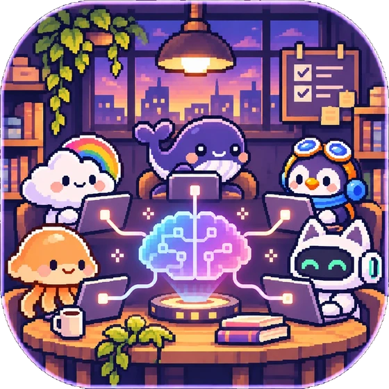

<p align="center">
  
</p>

<h1 align="center">OneBrain</h1>

<p align="center">
  <b>Deine Coding-Agents in einem Gruppenchat.</b><br>
  Claude Code, Codex und Gemini arbeiten zusammen auf deinem Mac.<br>
  Jeder liest nur, was für ihn neu ist. Lange Gespräche kosten bis zu 81 % weniger Tokens.
</p>

<p align="center">
  <b>81 % weniger Tokens</b> nach 100 Runden · <b>rund 1.000 Tokens</b> pro Runde, egal wie lang · <b>0 Tokens</b> im Leerlauf
</p>

<p align="center">
  <a href="https://github.com/0xTaoZ/onebrain/releases/latest"><b>⬇ Für macOS herunterladen</b></a>
  &nbsp;·&nbsp; <a href="README.md">English</a> · <a href="README.zh-CN.md">简体中文</a> · Deutsch
</p>

<p align="center">
  
  
  
</p>

## Installation

1. Lade `OneBrain_x.y.z_aarch64.dmg` unter [Releases](https://github.com/0xTaoZ/onebrain/releases/latest) herunter. Läuft auf Macs mit Apple Silicon (M1 oder neuer).
2. Öffne die Datei und ziehe **OneBrain** in den Ordner **Programme**.
3. Beim ersten Start blockiert macOS Apps, die nicht aus dem App Store oder von einem bezahlten Apple-Entwicklerkonto stammen. Öffne **Systemeinstellungen → Datenschutz & Sicherheit**, scrolle nach unten und klicke auf **Trotzdem öffnen**. Meldet macOS stattdessen, die App sei beschädigt, führe einmal im Terminal aus:
   ```sh
   xattr -dr com.apple.quarantine /Applications/OneBrain.app
   ```
4. Installiere mindestens einen Coding-Agent und melde dich dort an, zum Beispiel Claude Code, Codex oder Gemini CLI. OneBrain nutzt deine eigenen Abos und sieht deine Schlüssel nie. Lege eine Gruppe an, füge deine Agents hinzu und erwähne einen mit `@`.

## Warum es OneBrain gibt

Ich arbeite mit mehreren Coding-Agents gleichzeitig. Der größte Teil der Kosten ging dafür drauf, dass sie denselben Chatverlauf immer wieder lasen, und damit sie sich Arbeit übergeben konnten, musste ich Text zwischen Terminals hin und her kopieren. OneBrain bringt sie in einen Chat und gibt jedem nur das, was er braucht.

<p align="center">
  
</p>

## Im Vergleich

|  | Session-Manager<br><sub>Terminals nebeneinander</sub> | Gruppenchats in der Cloud | OneBrain |
| --- | :---: | :---: | :---: |
| Agents verschiedener Anbieter | ✓ | ✓ | ✓ |
| Agents übergeben sich Arbeit im selben Chat | – | ✓ | ✓ |
| Läuft lokal, ohne Konto | ✓ | – | ✓ |
| Wer später dazukommt, bekommt eine kurze Übergabe statt des Verlaufs | – | – | ✓ |
| Gemessene, nachprüfbare Token-Ersparnis | – | – | ✓ |

## Die Zahlen

Drei Agents (Entwicklung, Review, Test), pro Runde wird einer erwähnt. Beide Spalten geben den Agents dieselben Informationen.

| Gespräch | Verlauf neu lesen | OneBrain | Ersparnis |
| ---: | ---: | ---: | ---: |
| 10 Runden | 18.752 | 12.859 | **31 %** |
| 30 Runden | 85.208 | 37.135 | **56 %** |
| 60 Runden | 258.464 | 72.928 | **72 %** |
| 100 Runden | 633.264 | 123.388 | **81 %** |

Ein Reviewer, der nach 100 Runden dazukommt, startet mit **1.611** statt **11.364** Tokens.

Alle Zahlen stammen aus einem Befehl, der ein festes Gespräch durch den echten Prompt-Builder schickt. Du kannst sie selbst nachprüfen:

```sh
BENCH_TURNS=30 cargo test -p services --lib context_token_benchmark -- --ignored --nocapture
```

Methode: [docs/benchmarks/context-tokens.md](docs/benchmarks/context-tokens.md)

## So funktioniert es

Agents verschiedener Anbieter können keinen gemeinsamen Provider-Cache nutzen. Deshalb reicht OneBrain keine Transkripte herum. Jeder Agent behält sein eigenes Gespräch, und zwischen den Agents wandern nur kleine, stabile Bausteine.

- **Erwähnen, dann arbeiten.** Ein Agent läuft nur, wenn jemand ihn erwähnt.
- **Ein Lesezeichen pro Agent.** Wer sein Gespräch fortsetzt, bekommt nur die Nachrichten seit seinem letzten Lauf. Rolle und Teamregeln werden nicht erneut geschickt, solange sie gleich bleiben.
- **Team-Übergaben.** Neue Agents bekommen deine letzten Anfragen, das letzte Ergebnis und die geänderten Dateien der anderen und die festgehaltenen Entscheidungen. Alles stammt aus Daten, die der Chat ohnehin speichert; für eine Zusammenfassung wird kein Modellaufruf verbraucht.
- **Übergaben warten auf dich.** Schreibst du, während ein Agent arbeitet, wird seine Übergabe angezeigt, weckt aber den nächsten Agent nicht. So arbeitet niemand mit Vorgaben weiter, die du gerade geändert hast.
- **Cache-Trefferquote bei jeder Antwort.** Neue Eingabe, Cache-Treffer und Ausgabe, über Anbieter hinweg vereinheitlicht.

## Das gemeinsame Gehirn

Die meisten Agent-Werkzeuge behalten ihr Wissen im einzelnen Agent. OneBrain führt ein Gedächtnis für das ganze Team: Entscheidungen, Regeln, Erkenntnisse und Übergaben als einfaches Markdown, das jeder Agent öffnen, du lesen und git verfolgen kann. Jeder Eintrag behält seine Quelle, Agents schlagen vor, du gibst frei.

Schon verfügbar: gemeinsame Einträge, Team-Übergaben und ein Lesezeichen pro Agent. Als Nächstes: eine Seite in der App, um Einträge zu durchsuchen, freizugeben und zu bearbeiten.

## Außerdem

- Chat in warmem Weiß mit Pixel-Avataren für jede Agent-Laufzeit.
- Eine Heatmap im GitHub-Stil für die täglichen Läufe jedes Agents.
- Das Backend beendet sich mit der App, auch nach einem Absturz, und stoppt die Agent-Prozesse, die es gestartet hat.
- Auf Wunsch ein eigener Git-Worktree pro Gespräch, damit Agents nie in deine Arbeitskopie schreiben.

## Aus dem Quellcode bauen

Rust (Axum, SQLx, SQLite), React und TypeScript, Tauri.

```sh
pnpm install
pnpm run check
cargo test -p db -p services
```

---

<sub>Apache License 2.0. Basiert auf OpenTeams (Apache-2.0); siehe NOTICE.</sub>
