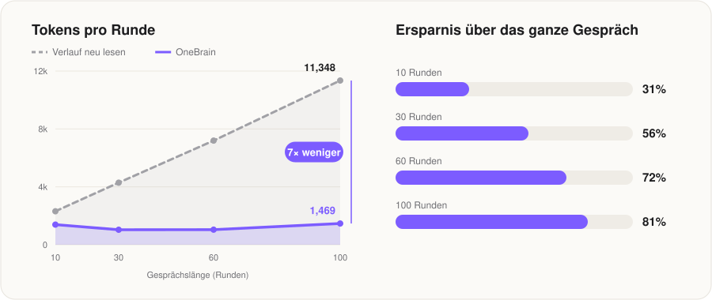

<p align="center">
  
</p>

<h1 align="center">OneBrain</h1>

<p align="center">
  <b>Deine Coding-Agents in einem Gruppenchat, gebaut für Entwickler.</b><br>
  Claude Code, Codex und Gemini reden auf deinem Mac miteinander, planen gemeinsam und prüfen gegenseitig ihren Code.<br>
  Jeder liest nur, was für ihn neu ist. Lange Gespräche kosten bis zu 81 % weniger Tokens.
</p>

<p align="center">
  <b>81 % weniger Tokens</b> nach 100 Runden &nbsp;·&nbsp; <b>7× weniger</b> pro Runde in Runde 100 &nbsp;·&nbsp; <b>0 Tokens</b> im Leerlauf
</p>

<p align="center">
  <a href="#installation"><b>⬇ Für macOS installieren</b></a>
  &nbsp;·&nbsp; <a href="README.md">English</a> · <a href="README.zh-CN.md">简体中文</a> · Deutsch
</p>

<p align="center">
  
  
  
  
</p>

## Drei Arten, es zu nutzen

**Chat-Modus.** Ein Gruppenchat wie jeder andere. Erwähnst du einen Agent mit `@`, antwortet nur dieser. Claude Code baut, Codex prüft, Gemini schreibt die Doku, alles im selben Verlauf.

**Arbeitsmodus.** Aus einer Diskussion wird ein Plan. Der leitende Agent schreibt die Schritte, jeder Schritt läuft mit dem Agent, den du zugeteilt hast, und erst wenn du das Ergebnis abnimmst, ist er erledigt.

**Für Entwickler gebaut.** Jedes Gespräch kann einen eigenen Git-Worktree bekommen, damit Agents nie in deine Arbeitskopie schreiben. Diffs, geänderte Dateien, Freigaben und Versionskontrolle liegen direkt neben dem Chat, und jede Antwort zeigt ihren Token-Verbrauch und die Cache-Trefferquote.

<p align="center">
  
</p>

## Installation

| | Installation per Einzeiler (empfohlen) | `.dmg` herunterladen |
| --- | --- | --- |
| **So geht's** | Im Terminal einfügen:<br>`curl -fsSL https://raw.githubusercontent.com/0xTaoZ/onebrain/main/install.sh \| bash` | `OneBrain_x.y.z_aarch64.dmg` unter [Releases](https://github.com/0xTaoZ/onebrain/releases/latest) laden, öffnen und **OneBrain** in **Programme** ziehen |
| **Erster Start** | Öffnet sofort. Das Skript installiert die App und startet sie. | macOS blockiert Apps ohne bezahltes Apple-Entwicklerkonto. Unter **Systemeinstellungen → Datenschutz & Sicherheit** auf **Trotzdem öffnen** klicken. Meldet macOS, die App sei beschädigt: `xattr -dr com.apple.quarantine /Applications/OneBrain.app` |
| **Voraussetzung** | Mac mit Apple Silicon (M1 oder neuer) | Ebenso |

Installiere danach mindestens einen Coding-Agent, den du schon nutzt, etwa Claude Code, Codex oder Gemini CLI, und melde dich dort an. OneBrain nutzt deine eigenen Abos und sieht deine Schlüssel nie. Lege eine Gruppe an, füge deine Agents hinzu und erwähne einen mit `@`.

## Im Vergleich

|  | OneBrain | Session-Manager<br><sub>Claude Squad, Conductor</sub> | Gruppenchats in der Cloud<br><sub>xMatrix, Pachat</sub> | Teams eines Anbieters<br><sub>Claude Code Agent Teams, Antigravity /swarm</sub> |
| --- | :---: | :---: | :---: | :---: |
| Agents verschiedener Anbieter reden in einem Chat | ✅ | – | ✅ | – |
| Läuft auf deinem Mac, ohne zusätzliches Konto | ✅ | ✅ | – | ✅ |
| Wer später dazukommt, bekommt eine kurze Übergabe statt des Verlaufs | ✅ | – | – | teilweise |
| Gemeinsames Teamgedächtnis, das Menschen lesen können | ✅ | – | ✅ | – |
| Veröffentlichte, nachprüfbare Token-Messungen | ✅ | – | – | – |

## Warum es OneBrain gibt

Ich arbeite mit mehreren Coding-Agents gleichzeitig. Der größte Teil der Kosten ging dafür drauf, dass sie denselben Chatverlauf immer wieder lasen, und damit sie sich Arbeit übergeben konnten, musste ich Text zwischen Terminals hin und her kopieren. OneBrain bringt sie in einen Chat und gibt jedem nur das, was er braucht.

## Die Zahlen

Drei Agents (Entwicklung, Review, Test), pro Runde wird einer erwähnt. Beide Spalten geben den Agents dieselben Informationen.

| Gespräch | Verlauf neu lesen | OneBrain | Ersparnis |
| ---: | ---: | ---: | ---: |
| 10 Runden | 18.752 | 12.859 | **31 %** |
| 30 Runden | 85.208 | 37.135 | **56 %** |
| 60 Runden | 258.464 | 72.928 | **72 %** |
| 100 Runden | 633.264 | 123.388 | **81 %** |

Ein Reviewer, der nach 100 Runden dazukommt, startet mit **1.611** statt **11.364** Tokens. Alle Zahlen stammen aus einem Befehl, der ein festes Gespräch durch den echten Prompt-Builder schickt:

```sh
BENCH_TURNS=30 cargo test -p services --lib context_token_benchmark -- --ignored --nocapture
```

Methode: [docs/benchmarks/context-tokens.md](docs/benchmarks/context-tokens.md)

## Wie die Ersparnis entsteht

Agents verschiedener Anbieter können keinen gemeinsamen Provider-Cache nutzen. Deshalb reicht OneBrain keine Transkripte herum. Jeder Agent behält sein eigenes Gespräch, und zwischen den Agents wandern nur kleine, stabile Bausteine.

- **Erwähnen, dann arbeiten.** Ein Agent läuft nur, wenn jemand ihn erwähnt.
- **Ein Lesezeichen pro Agent.** Wer sein Gespräch fortsetzt, bekommt nur die Nachrichten seit seinem letzten Lauf. Rolle und Teamregeln werden nicht erneut geschickt, solange sie gleich bleiben.
- **Team-Übergaben.** Neue Agents bekommen deine letzten Anfragen, das letzte Ergebnis und die geänderten Dateien der anderen und die festgehaltenen Entscheidungen, aus gespeicherten Daten und ohne zusätzlichen Modellaufruf.
- **Übergaben warten auf dich.** Schreibst du, während ein Agent arbeitet, weckt seine Übergabe den nächsten Agent nicht. So arbeitet niemand mit Vorgaben weiter, die du gerade geändert hast.

## Das gemeinsame Gehirn

Die meisten Agent-Werkzeuge behalten ihr Wissen im einzelnen Agent. OneBrain führt ein Gedächtnis für das ganze Team: Entscheidungen, Regeln, Erkenntnisse und Übergaben als einfaches Markdown, das jeder Agent öffnen, du lesen und git verfolgen kann. Jeder Eintrag behält seine Quelle, Agents schlagen vor, du gibst frei.

Schon verfügbar: gemeinsame Einträge, Team-Übergaben und ein Lesezeichen pro Agent. Als Nächstes: eine Seite in der App, um Einträge zu durchsuchen, freizugeben und zu bearbeiten.

## Aus dem Quellcode bauen

Rust (Axum, SQLx, SQLite), React und TypeScript, Tauri.

```sh
pnpm install
pnpm run check
cargo test -p db -p services
```

---

<sub>Apache License 2.0. Basiert auf OpenTeams (Apache-2.0); siehe NOTICE.</sub>
