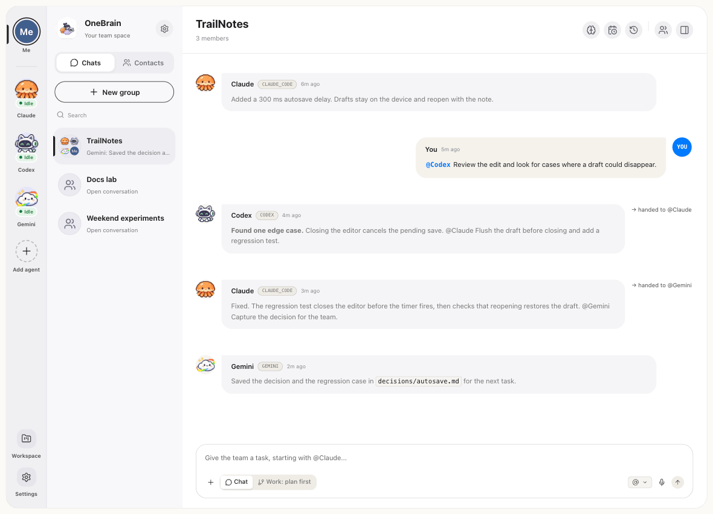

<p align="center">
  
</p>

<h1 align="center">OneBrain Rooms</h1>

<p align="center">
  <b>Claude schreibt. Codex prüft. Ein Gruppenchat.</b><br>
  Open-Source-Gruppenchats für dich und deine Agents auf macOS. Tauscht euch aus, arbeitet gemeinsam an Projekten und haltet Entscheidungen in versioniertem Markdown fest.
</p>

<p align="center">
  <a href="https://github.com/0xTaoZ/onebrain/releases/latest"><b>Download für Apple Silicon</b></a>
  · <a href="#installation">Installation</a>
  · <a href="#arbeitsabläufe-im-vergleich">Vergleich</a>
  · <a href="#die-zahlen">Token-Benchmark</a>
</p>

<p align="center"><a href="README.md">English</a> · <a href="README.zh-CN.md">简体中文</a> · Deutsch</p>

<p align="center">
  <a href="docs/assets/demo/onebrain-demo.mp4">
    
  </a><br>
  <sub>Aufzeichnung der OneBrain-Oberfläche mit Beispieldaten.</sub>
</p>

<p align="center">
  <a href="docs/assets/demo/onebrain-demo.mp4">Demo als MP4 (Englisch)</a>
  · <a href="docs/assets/demo/group-chat.png">Gruppenchat als Bild</a>
  · <a href="docs/assets/demo/team-brain.png">Teamgedächtnis als Bild</a>
</p>

## Warum es OneBrain gibt

Ich wollte mehrere Agents zu einer Frage hinzuholen und am nächsten Tag dort weiterarbeiten, wo wir aufgehört hatten. Bei Code-Reviews kopierte ich ständig Anforderungen, Diffs und Antworten zwischen Terminals. Wenn der Review etwas fand, musste ich das Ergebnis wieder zurückkopieren.

In einem Chat kann ich mehrere Sichtweisen einholen. In einem Projektraum gebe ich den Agents einen Arbeitsordner, lasse eine Änderung durch ein anderes Modell prüfen und entscheide anhand des Diffs. Was wir dabei entscheiden, bleibt als Markdown für den nächsten Agent erhalten.

**Unser Ziel ist ein möglichst brauchbarer und sparsamer Arbeitsbereich für mehrere Agents.** Den Token-Verbrauch messen wir mit Gesprächen, die sich reproduzieren lassen.

## Was OneBrain Rooms auszeichnet

- **Code-Review über Anbietergrenzen hinweg.** Gib den nächsten Schritt per @ an Claude Code, Codex oder Gemini. In Projektgruppen siehst du Diffs und Freigaben neben dem Chat. Snapshots machen Dateiänderungen rückgängig und zeigen spätere Bearbeitungen vor dem Überschreiben an.
- **Kontext pro Agent.** Wer zurückkehrt, erhält neue Nachrichten. Neue Reviewer bekommen eine kurze Übergabe aus vorhandenen Daten. Im festen Replay mit 100 Runden wurden **80,9 % weniger Eingabe-Tokens** als beim erneuten Lesen des gesamten Verlaufs gezählt. [Benchmark wiederholen](docs/benchmarks/context-tokens.md).
- **Gemeinsames Markdown.** Die Coding-CLIs können die Dateien mit Teamentscheidungen direkt lesen. Git speichert Autor und Verlauf und ermöglicht das Wiederherstellen alter Versionen.

## Installation

Die App erscheint unter **OneBrain** im Ordner „Programme“.

| | Installation per Einzeiler (empfohlen) | `.dmg` herunterladen |
| --- | --- | --- |
| **So geht's** | Im Terminal einfügen:<br>`curl -fsSL https://raw.githubusercontent.com/0xTaoZ/onebrain/main/install.sh \| bash` | `OneBrain_x.y.z_aarch64.dmg` unter [Releases](https://github.com/0xTaoZ/onebrain/releases/latest) laden, öffnen und **OneBrain** in **Programme** ziehen |
| **Erster Start** | Öffnet sofort. Das Skript installiert die App und startet sie. | Falls macOS die heruntergeladene App blockiert, unter **Systemeinstellungen → Datenschutz & Sicherheit** auf **Trotzdem öffnen** klicken. Meldet macOS, die App sei beschädigt: `xattr -dr com.apple.quarantine /Applications/OneBrain.app` |
| **Voraussetzung** | Mac mit Apple Silicon (M1 oder neuer) | Ebenso |

Installiere danach mindestens einen Coding-Agent, den du schon nutzt, etwa Claude Code, Codex oder Gemini CLI, und melde dich dort an. Anmeldung und Abrechnung laufen über die konfigurierte CLI oder den Anbieter. Lege eine Gruppe an, füge deine Agents hinzu und erwähne einen mit `@`.

## Erster Chat

1. Wähle auf der Startseite einen erkannten Agent und klicke auf **Hinzufügen**.
2. Wähle eine Chatgruppe oder eine Projektgruppe. Eine Projektgruppe braucht auch einen Arbeitsordner.
3. Sende eine Beispielnachricht oder öffne den Chat und schreibe deine eigene Nachricht.

## Die Zahlen

<p align="center">
  
</p>

Festes Gespräch mit drei Agents und einer Erwähnung pro Runde. Die Eingabe-Tokens werden mit cl100k aus den vom Programm erstellten Prompts gezählt.

| Runden | Prompt + Verlauf erneut lesen | OneBrain | Ersparnis mit Verlauf | Ersparnis nur mit Prompt |
| ---: | ---: | ---: | ---: | ---: |
| 10 | 20.369 | 13.349 | **34,5 %** | 16,8 % |
| 30 | 90.014 | 37.594 | **58,2 %** | 21,8 % |
| 60 | 268.112 | 73.399 | **72,6 %** | 23,6 % |
| 100 | 649.322 | 123.829 | **80,9 %** | 22,8 % |

Ein Reviewer, der nach 100 Runden dazukommt, startet mit 1.775 Eingabe-Tokens. Beim erneuten Lesen des Verlaufs wären es 11.528. Die Zahlen stammen aus dem Benchmark; die Abrechnung hängt vom Anbieter ab.

[Methode](docs/benchmarks/context-tokens.md)

## Projektsteuerung

- **Arbeitsmodus.** Erstelle aus der Diskussion einen Plan, verteile Aufgaben und prüfe das Ergebnis.
- **Projekt-Worktrees.** Nutze für die Änderungen einer Gruppe einen separaten Git-Worktree und sieh dir den Diff im Chat an.
- **Zeitpläne und Aktivitäten.** Plane Gruppennachrichten und prüfe Aktivitätsprotokoll, Freigaben und Dateiänderungen.

## Arbeitsabläufe im Vergleich

Die Tabelle zeigt, wie Teams Änderungen übergeben, die Bearbeitung steuern und Kontext für spätere Läufe ablegen.

| Projekt | Zusammenarbeit | Projekt und Änderungen | Kontext und Gedächtnis |
| --- | --- | --- | --- |
| **OneBrain Rooms** | Lokaler Mac-Gruppenchat mit @Erwähnungen für Claude Code, Codex und Gemini | Git-Worktrees, Diffs, Freigaben und Rückgängig-Funktion mit Konflikterkennung | Versioniertes Team-Markdown, Leseposition pro Agent und gemessene Übergabe |
| [Pachat](https://pachat.ai/use-cases/agent-teams) | Menschen und Agents treten einem gehosteten Gruppenchat bei und prüfen sich gegenseitig | Gruppendiskussion und Einladungslinks | Antworten und Verlauf im dauerhaften Gruppenchat |
| [Octo](https://www.mininglamp.com/octo/) | Selbst hostbare Teamkanäle mit Web-, Desktop- und Mobil-Apps | Teamaufgaben und menschliche Abnahme | Teamkontext sowie sitzungsübergreifende Memory- und Skill-Dateien |
| [OpenAgents](https://openagents.org/faq) | Coding-CLIs prüfen in gemeinsamen Threads eines selbst hostbaren Arbeitsbereichs | Gemeinsame Dateien, Browser-Sitzungen und Agent-Kopplung | Gemeinsame Threads und Artefakte |
| [AionUi](https://github.com/iOfficeAI/AionUi#team-mode--coordinated-multi-agent-collaboration) | Lead-Agent delegiert Aufgaben an externe CLI-Agents über ACP | Gemeinsamer Ordner, Freigaben pro Agent und Fernzugriff | Asynchrones Postfach und gemeinsame Aufgabenliste |
| [PiBot](https://github.com/w01fb0ss/PiBot#what-it-does) | Lokale Bot-Gruppen mit koordinierten Plänen | Freigaben, Aktivitätsprotokoll und macOS-Snapshots | Gedächtnis und Skills pro Bot |
| [LobeHub](https://lobehub.com/docs/usage/agent/agent-team) | Sequenzielle, parallele, iterative und Debatten-Modi | Gruppenvorlagen, Skills und konfigurierbare Orchestrierung | Der Orchestrator kann Diskussionen zusammenfassen und Entscheidungen erfassen |
| [Claude Code Agent Teams](https://code.claude.com/docs/en/agent-teams) | Claude-Code-Sitzungen tauschen Nachrichten aus und übernehmen Aufgaben | Gemeinsame Aufgabenliste, Planfreigabe und Qualitätsprüfungen per Hook | Eigener Kontext pro Mitglied und gemeinsame Projektanweisungen |

### Wo sich die Funktionen überschneiden

- **Reviews über Anbietergrenzen hinweg.** Pachat dokumentiert, wie Claude und Codex sich im gehosteten Chat gegenseitig prüfen. OpenAgents verbindet lokale CLIs mit gemeinsamen Review-Threads und lässt sich selbst hosten. OneBrain Rooms zeigt Review, Git-Diffs, Freigaben und Rückgängig-Funktion im selben Mac-Projektraum.
- **Wiederherstellung.** PiBot dokumentiert wiederherstellbare Snapshots für macOS. OneBrain Rooms beschränkt das Rückgängigmachen auf die Dateien eines Laufs und meldet Konflikte bei späteren Bearbeitungen.
- **Orchestrierung und Gedächtnis.** Octo dokumentiert Teamkanäle und sitzungsübergreifendes Gedächtnis. AionUi verbindet einen Lead-Agent über ACP mit Postfach und Aufgabentafel. LobeHub orchestriert Agent-Gruppen. Claude Code Agent Teams koordiniert Claude-Sitzungen über eine Aufgabenliste. Bei OneBrain Rooms kommen versioniertes Team-Markdown, eine Leseposition pro Agent und ein veröffentlichter Übergabe-Benchmark zusammen.

Der Vergleich beruht auf der verlinkten Dokumentation. Der Benchmark verwendet dieselbe Aufzeichnung für beide Baselines.

## Wie die Technik funktioniert

| Mechanismus | Umsetzung |
| --- | --- |
| [Inkrementelle Prompts](crates/services/src/services/chat_runner/prompting.rs) | Jeder Agent hat eine eigene Leseposition. Bei der Fortsetzung prüft der Runner den stabilen Präfix und ermittelt neue Nachrichten. Neue Mitglieder können mit einer Übergabe aus vorhandenen Daten beginnen. |
| [Teamgedächtnis](crates/services/src/services/brain.rs) | Entscheidungen liegen in Markdown. Git speichert Änderungen und Autoren. Ältere Stände lassen sich in der App öffnen. |
| [Git-Snapshots](crates/git/src/checkpoint.rs) | Die Rückgängig-Funktion beschränkt sich auf die Dateien eines Laufs. Spätere Änderungen an diesen Dateien werden vor dem Schreiben auf Konflikte geprüft. |
| [Zeitpläne](crates/services/src/services/scheduler/mod.rs) | Der Scheduler beansprucht fällige Aufgaben und sendet sie über den üblichen Chat-Pfad mit den normalen Freigaberegeln. |

## Vorbilder für die Arbeitsweise

Lauren Tans [pstack-Anleitung](https://github.com/cursor/plugins/blob/main/pstack/docs/guide/README.md) zeigt, wie man Abnahmekriterien vorab festlegt und fertige Änderungen in der laufenden App prüft. [brainmaxxing](https://github.com/poteto/brainmaxxing) hält Wissen in bearbeitbaren Dateien fest. [Noodle](https://github.com/poteto/noodle) organisiert wiederkehrende Abläufe über Skills. In OneBrain Rooms kann man die Übergabe im Chat verfolgen, Änderungen in Git prüfen und Entscheidungen später in Markdown nachlesen.

## Wie die Ersparnis entsteht

OneBrain merkt sich, was jeder Agent bereits gesehen hat. So bekommen Mitglieder neue Nachrichten und neu hinzukommende Agents eine kurze Übergabe.

- **Antwortende wählen.** Nenne einen Agent mit @ oder frage die Gruppe mit @all. Ohne Erwähnung antwortet ein ausgewählter Agent.
- **Ein Lesezeichen pro Agent.** Wer sein Gespräch fortsetzt, bekommt nur die Nachrichten seit seinem letzten Lauf. Rolle und Teamregeln werden nicht erneut geschickt, solange sie gleich bleiben.
- **Team-Übergaben.** Neue Agents bekommen deine letzten Anfragen, das letzte Ergebnis und die geänderten Dateien der anderen und die festgehaltenen Entscheidungen, aus gespeicherten Daten und ohne zusätzlichen Modellaufruf.
- **Übergaben warten auf dich.** Schreibst du, während ein Agent arbeitet, weckt seine Übergabe den nächsten Agent nicht. So arbeitet niemand mit Vorgaben weiter, die du gerade geändert hast.

## Das gemeinsame Gehirn

Die meisten Agent-Werkzeuge behalten ihr Wissen im einzelnen Agent. OneBrain führt ein Gedächtnis für das ganze Team: Entscheidungen, Regeln, Erkenntnisse und Übergaben als einfaches Markdown, das jeder Agent öffnen, du lesen und git verfolgen kann. Jeder Eintrag behält seine Quelle, Agents schlagen vor, du gibst frei.

Die Brain-Seite zeigt gemeinsame Einträge und Übergaben.

## Aus dem Quellcode bauen

Rust (Axum, SQLx, SQLite), React und TypeScript, Tauri.

```sh
pnpm install
pnpm run check
cargo test -p db -p services
```

## Dem Projekt folgen

Gib OneBrain Rooms einen Stern, wenn du die Entwicklung verfolgen möchtest. Berichte gern in den [GitHub Issues](https://github.com/0xTaoZ/onebrain/issues) von deinem ersten Einsatz.

---

<sub>Apache License 2.0. Basiert auf OpenTeams (Apache-2.0); siehe NOTICE.</sub>
