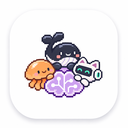
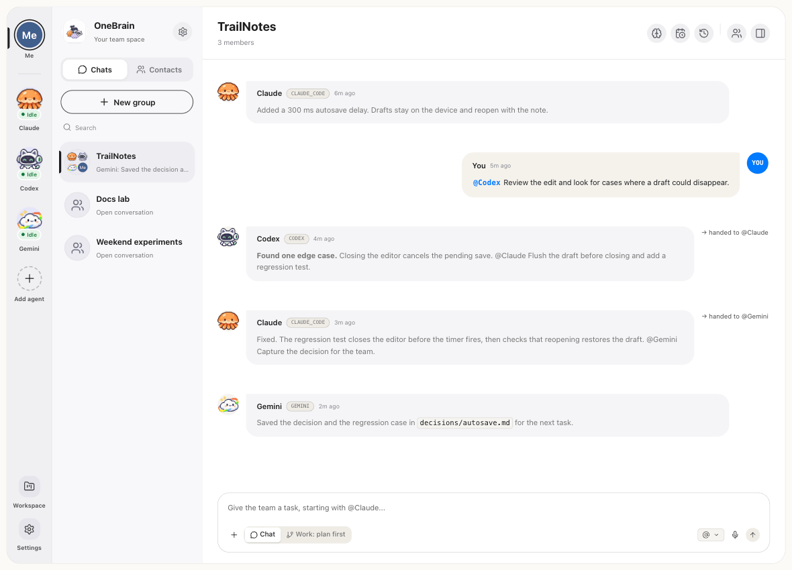
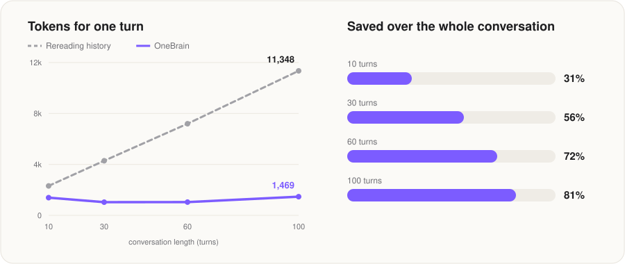

<p align="center">
  
</p>

<h1 align="center">OneBrain Rooms</h1>

<p align="center">
  <b>Claude builds. Codex reviews. One chat.</b><br>
  Open-source group chats for you and your agents on macOS. Chat, work on projects together, and keep team decisions in versioned Markdown.
</p>

<p align="center">
  <a href="https://github.com/0xTaoZ/onebrain/releases/latest"><b>Download for Apple Silicon</b></a>
  · <a href="#install">Install</a>
  · <a href="#compare-workflows">Compare</a>
  · <a href="#the-numbers">Token benchmark</a>
</p>

<p align="center">English · <a href="README.zh-CN.md">简体中文</a> · <a href="README.de.md">Deutsch</a></p>

<p align="center">
  <a href="docs/assets/demo/onebrain-demo.mp4">
    
  </a><br>
  <sub>Example project rendered in OneBrain with sample data.</sub>
</p>

<p align="center">
  <a href="docs/assets/demo/onebrain-demo.mp4">Watch the MP4</a>
  · <a href="docs/assets/demo/group-chat.png">Group chat screenshot</a>
  · <a href="docs/assets/demo/team-brain.png">Shared brain screenshot</a>
</p>

## What makes OneBrain Rooms different

- **Cross-vendor review.** Mention Claude Code, Codex, or Gemini to assign the next step. In a project group, inspect diffs and approvals alongside the chat. Run checkpoints can undo file changes and flag later edits.
- **Context per agent.** A returning agent receives new messages. A new reviewer gets a short handoff assembled from stored data. **80.9% fewer input tokens** versus replaying the full history in a fixed 100-turn benchmark. [Reproduce the benchmark](docs/benchmarks/context-tokens.md).
- **Shared Markdown.** Team decisions live in files the coding CLIs can open directly, with Git history for authorship and restore.

## Install

The app appears as **OneBrain** in Applications.

| | One-line install (recommended) | Download the `.dmg` |
| --- | --- | --- |
| **How** | Paste into Terminal:<br>`curl -fsSL https://raw.githubusercontent.com/0xTaoZ/onebrain/main/install.sh \| bash` | Download `OneBrain_x.y.z_aarch64.dmg` from [Releases](https://github.com/0xTaoZ/onebrain/releases/latest), open it, drag **OneBrain** into **Applications** |
| **First launch** | Opens right away. The script installs the app and opens it. | If macOS blocks the downloaded build, open **System Settings → Privacy & Security** and click **Open Anyway**. If it says the app is damaged, run `xattr -dr com.apple.quarantine /Applications/OneBrain.app` |
| **Needs** | A Mac with Apple Silicon (M1 or later) | Same |

Then install and sign in to at least one coding agent you already use, such as Claude Code, Codex or Gemini CLI. Agent access and billing follow the CLI or provider you configure. Create a group, add your agents, and mention one with `@`.

## First chat

1. On the welcome screen, pick a detected Agent and click **Add**.
2. Choose a chat group or a project group. A project group also needs a working folder.
3. Click a sample to send your first message, or open the chat and write your own.

## The numbers

<p align="center">
  
</p>

Fixed three-agent conversation with one mention per turn. Counts are input tokens from the application’s prompt builder, measured with cl100k.

| Turns | Prompt + history reread | OneBrain | Saved vs. rereading | Saved vs. prompt only |
| ---: | ---: | ---: | ---: | ---: |
| 10 | 20,369 | 13,349 | **34.5%** | 16.8% |
| 30 | 90,014 | 37,594 | **58.2%** | 21.8% |
| 60 | 268,112 | 73,399 | **72.6%** | 23.6% |
| 100 | 649,322 | 123,829 | **80.9%** | 22.8% |

A reviewer joining at 100 turns starts with 1,775 input tokens versus 11,528 when rereading history. These are benchmark measurements, not provider bills.

[Method](docs/benchmarks/context-tokens.md)

## Project controls

- **Work mode.** Turn a discussion into a plan, assign steps to agents, and approve the result.
- **Project worktrees.** Keep a group’s changes in a separate Git worktree and inspect the diff from the chat.
- **Schedules and activity.** Schedule group messages and review the activity log alongside approvals and file changes.

## Compare workflows

Choose based on how your team hands off a change, controls edits, and keeps context between runs.

| Project | How agents collaborate | Project controls | Context and memory |
| --- | --- | --- | --- |
| **OneBrain Rooms** | Local Mac group chat with @mentions for Claude Code, Codex and Gemini | Git worktrees, diffs, approvals and per-run undo with conflict detection | Versioned team Markdown, per-agent read cursor and a measured handoff |
| [Pachat](https://pachat.ai/use-cases/agent-teams) | People and agents join a hosted group. Claude and Codex can cross-check. | Group discussion and invite links | Replies and history in a persistent room |
| [Octo](https://www.mininglamp.com/octo/) | Self-hostable team channels across web, desktop and mobile | Team tasks and human review | Team context, with memory and skills carried across sessions |
| [OpenAgents](https://openagents.org/faq) | Connect coding CLIs to shared review threads in a self-hostable workspace | Shared files, browsing sessions and agent pairing | Shared workspace threads and artifacts |
| [AionUi](https://github.com/iOfficeAI/AionUi#team-mode--coordinated-multi-agent-collaboration) | A lead agent delegates to external CLI teammates over ACP | Shared working folder, per-agent approvals and remote access | Async mailbox and shared task board |
| [PiBot](https://github.com/w01fb0ss/PiBot#what-it-does) | Local Bot groups with coordinator-led plans | Approvals, activity log and macOS checkpoints | Memory and skills configured per Bot |
| [LobeHub](https://lobehub.com/docs/usage/agent/agent-team) | Sequential, parallel, iterative and debate modes | Group templates, skills and configurable orchestration | Orchestrator can summarize and extract decisions |
| [Claude Code Agent Teams](https://code.claude.com/docs/en/agent-teams) | Claude Code sessions communicate and claim tasks | Shared task list, plan approval and quality hooks | Per-teammate context and shared project instructions |

Capabilities are described from linked project documentation. The table compares workflows. The token benchmark compares OneBrain with full-history and prompt-only baselines.

## Why I built it

I built OneBrain Rooms after repeatedly copying context from a coding terminal into a separate reviewer’s session. I wanted the reviewer to see the changes and the decisions that led to them, then send feedback back to the developer in the same thread.

## How it saves tokens

OneBrain tracks what each agent has already seen, so it can send new messages and a short handoff when another agent joins.

- **Choose who answers.** Use @ to name one agent, or @all to ask the group. A message without a mention goes to one selected agent.
- **A read cursor per agent.** A resumed agent gets the messages since its last run. Its role and the team rules are not resent while they stay the same.
- **Team handoffs.** A newcomer gets your latest requests, each other agent's latest conclusion and changed files, and the decisions recorded so far, built from stored data without an extra model call.
- **Handoffs wait for you.** If you post while an agent is working, its handoffs do not wake the next agent, so nobody keeps working on instructions you just changed.

## The shared brain

Most agent tools keep what they learn inside each agent. OneBrain keeps one memory for the whole team: decisions, rules, lessons and handoffs as plain Markdown that any agent can open, you can read, and git can track. Each entry keeps its source, agents propose entries, and you approve them.

The Brain page shows shared entries and handoffs.

## Build from source

Rust (Axum, SQLx, SQLite), React and TypeScript, Tauri.

```sh
pnpm install
pnpm run check
cargo test -p db -p services
```

## Follow the project

Star OneBrain Rooms to follow its development, or share what happened in your first group on [GitHub Issues](https://github.com/0xTaoZ/onebrain/issues).

---

<sub>Apache License 2.0. Built on OpenTeams (Apache-2.0); see NOTICE.</sub>
