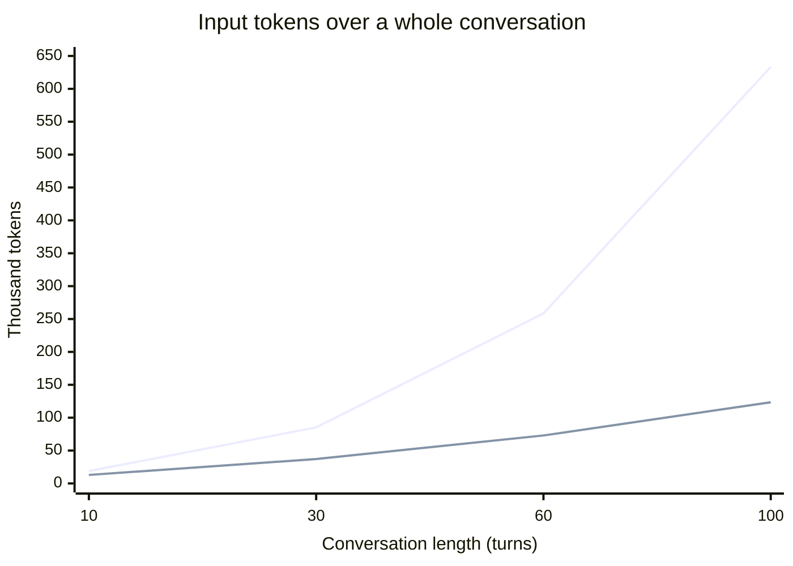

# OneBrain

A desktop workspace where several coding agents share one group chat and one project memory. Only the agents you mention run, and each one reads only what it has not seen yet.



Upper line: every agent rereads the session history when it needs context. Lower line: OneBrain.

## Results

Three agents (coder, reviewer, tester) in one conversation, one agent mentioned per turn. Both columns give the agents the same information.

| Conversation length | Rereading history | OneBrain | Saved | Last turn |
| ---: | ---: | ---: | ---: | ---: |
| 10 turns | 18,752 | 12,859 | 31% | 2,313 → 1,392 |
| 30 turns | 85,208 | 37,135 | 56% | 4,289 → 1,035 |
| 60 turns | 258,464 | 72,928 | 72% | 7,194 → 1,041 |
| 100 turns | 633,264 | 123,388 | 81% | 11,348 → 1,469 |

The last column is the point. When agents reread history, every turn costs more than the one before. With OneBrain the cost of a turn stays around a thousand tokens however long the conversation gets.

An agent that joins late, for example a second reviewer called in after 100 turns, starts with 1,611 tokens instead of 11,364.

| Joins after | Rereading history | OneBrain | Saved |
| ---: | ---: | ---: | ---: |
| 10 turns | 2,324 | 1,587 | 32% |
| 30 turns | 4,308 | 1,595 | 63% |
| 60 turns | 7,215 | 1,556 | 78% |
| 100 turns | 11,364 | 1,611 | 86% |

Every number comes from one command that replays a fixed conversation through the production prompt builder:

```sh
BENCH_TURNS=30 cargo test -p services --lib context_token_benchmark -- --ignored --nocapture
```

Method: [docs/benchmarks/context-tokens.md](docs/benchmarks/context-tokens.md).

## How it saves tokens

Agents from different vendors cannot share a provider cache, so OneBrain does not try to share transcripts between them. Each agent keeps its own conversation, and only small, stable pieces cross between agents.

**Mention to run.** An agent runs only when someone mentions it. Idle agents cost nothing.

**A read cursor per agent.** A resumed agent receives the messages posted since its last run, not the whole history. Its role and the team rules are not resent while they stay the same. The cursor moves forward only after a run succeeds, so a failed run never hides messages from the next one.

**Team handoffs for newcomers.** An agent that is new to a conversation gets your latest requests, each other agent's latest conclusion and changed files, and the decisions recorded so far. All of it comes from data the session already stores, so no extra model call is made to write a summary. The full history stays one file read away.

**Handoffs wait for you.** If you post while an agent is working, its handoffs to other agents are shown but do not wake them. A chain of agents does not keep running on instructions you have just changed.

**Cache hit rate on every reply.** Each agent reply shows fresh input, cached input and output tokens, with the share served from the provider cache. Providers count cached tokens differently, so the numbers are normalised before they are compared.

## The shared brain

Most agent setups keep their knowledge inside each agent: a long chat history, or memory files only the agent that wrote them reads. OneBrain keeps one memory for the whole team, and it is meant to be read by people as much as by agents. The design:

- Decisions, rules, lessons and handoffs are plain Markdown files. Any agent CLI can open them, people can read them, and git shows how they changed.
- Every entry keeps its source: the message it came from, or the file and lines it describes. When those files change, the entry is marked out of date so it does not quietly mislead the next agent.
- Agents propose entries; you approve them. Nothing becomes team knowledge without a person seeing it.

Live today: shared records written by agents, team handoffs built from them, and per-agent read cursors. In progress: a page in the app to browse, approve and edit the brain, with stale entries flagged.

The idea came first and the app came second. Before OneBrain existed, the same approach kept several coding agents on one machine in step through shared Markdown files and a written set of rules. OneBrain turns that habit into a product.

## Also in the app

- Group chat in a warm white theme, with pixel-art avatars for each agent runtime and a GitHub-style heatmap of each agent's daily runs.
- The backend shuts down with the app, even after a crash or a force quit, and stops the agent processes it started.
- Optional Git worktree per conversation, so agents do not write over your working copy.

Runtimes: Claude Code, Codex, Gemini CLI, Qwen Code, OpenCode, Amp and more.

## Stack

Rust (Axum, SQLx, SQLite) for the backend, React and TypeScript for the frontend, Tauri for the desktop app.

```sh
pnpm install
pnpm run check
cargo test -p db -p services
```

## Credits

Apache License 2.0. OneBrain is built on [OpenTeams](https://github.com/openteams-lab/openteams), also Apache-2.0; see [NOTICE](NOTICE).
