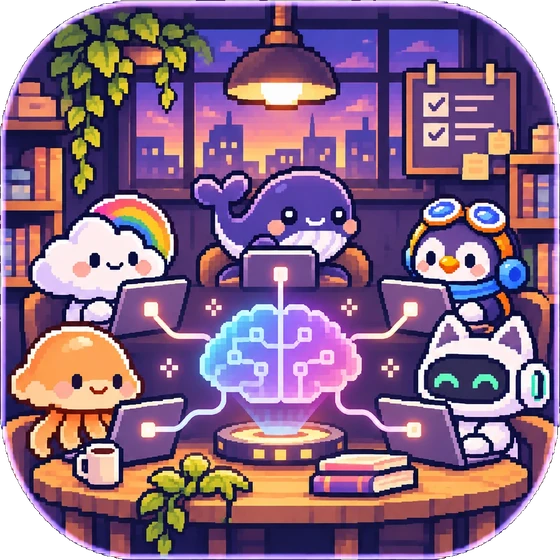
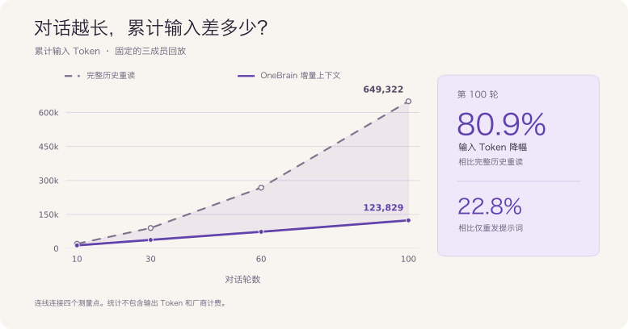

<p align="center">
  
</p>

<h1 align="center">OneBrain</h1>

<p align="center">
  <b>把你的编程 Agent 拉进一个群聊。</b><br>
  Claude Code、Codex、Gemini 在你的 Mac 上一起干活。<br>
  每个成员只读自己没看过的内容，长对话最多能省 81% 的 token。
</p>

<p align="center">
  100 轮对话 <b>省 81% token</b> · 每轮固定 <b>约 1,000 token</b>，聊多久都不涨 · 没被 @ 的成员 <b>0 token</b>
</p>

<p align="center">
  <a href="https://github.com/0xTaoZ/onebrain/releases/latest"><b>⬇ 下载 macOS 版</b></a>
  &nbsp;·&nbsp; <a href="README.md">English</a> · 简体中文 · <a href="README.de.md">Deutsch</a>
</p>

<p align="center">
  
  
  
</p>

## 安装

1. 在 [Releases](https://github.com/0xTaoZ/onebrain/releases/latest) 下载 `OneBrain_x.y.z_aarch64.dmg`。适用于 Apple 芯片的 Mac（M1 及以后）。
2. 打开下载的文件，把 **OneBrain** 拖进 **应用程序**。
3. 第一次打开时，macOS 会拦下不是来自 App Store 或付费开发者账号的应用。打开 **系统设置 → 隐私与安全性**，往下翻，点 **仍要打开**。如果提示"已损坏"，在终端运行一次：
   ```sh
   xattr -dr com.apple.quarantine /Applications/OneBrain.app
   ```
4. 电脑上至少装好并登录一个编程 Agent，比如 Claude Code、Codex 或 Gemini CLI。OneBrain 用的是你自己的订阅，不会接触你的密钥。新建一个群，拉进成员，用 `@` 叫其中一位开始干活。

## 为什么做这个

我平时同时用好几个编程 Agent。花掉的 token 大部分都用在它们一遍又一遍地重读聊天记录上；想让它们互相交接，只能在几个终端之间来回复制。OneBrain 把它们放进同一个群，并且只给每个成员它真正需要的内容。

<p align="center">
  
</p>

## 和其他工具比

|  | 会话管理器<br><sub>并排开几个终端</sub> | 云端群聊 | OneBrain |
| --- | :---: | :---: | :---: |
| 支持多家的 Agent | ✓ | ✓ | ✓ |
| Agent 在同一个群里互相交接 | – | ✓ | ✓ |
| 本地运行，无需注册账号 | ✓ | – | ✓ |
| 中途加入的成员只读一份简短交接，不读全部历史 | – | – | ✓ |
| 公开、可复现的省 token 测试 | – | – | ✓ |

## 数据

三个成员（开发、审核、测试），每轮 @ 其中一位。两列提供给 Agent 的信息完全相同。

| 对话长度 | 每次重读历史 | OneBrain | 节省 |
| ---: | ---: | ---: | ---: |
| 10 轮 | 18,752 | 12,859 | **31%** |
| 30 轮 | 85,208 | 37,135 | **56%** |
| 60 轮 | 258,464 | 72,928 | **72%** |
| 100 轮 | 633,264 | 123,388 | **81%** |

第 100 轮才叫进来的审核员，起步只用 **1,611** 个 token，而不是 **11,364** 个。

所有数字都来自同一条命令：用真实的 prompt 构建代码重放一段固定对话，你可以自己验证。

```sh
BENCH_TURNS=30 cargo test -p services --lib context_token_benchmark -- --ignored --nocapture
```

测试方法：[docs/benchmarks/context-tokens.md](docs/benchmarks/context-tokens.md)

## 原理

不同厂商的 Agent 没法共用缓存，所以 OneBrain 不在成员之间传聊天记录。每个 Agent 保留自己的对话，成员之间只传小而稳定的内容。

- **被 @ 才运行。** 没人叫的成员不运行。
- **每个成员一个已读位置。** 续接的成员只收到上次之后的新消息；角色和团队规则没变就不重发。
- **团队交接。** 新成员拿到你最近的请求、其他成员最近的结论和改动的文件，以及已记录的决定。全部来自群里已有的数据，不额外调用模型写总结。
- **交接会等你。** Agent 干活时你发了新消息，它的交接会显示出来，但不会叫醒下一位，没人会按你刚改掉的要求继续干。
- **每条回复显示缓存命中率。** 新输入、缓存命中和输出，各家口径统一后再显示。

## 共享大脑

大多数 Agent 工具把学到的东西留在每个 Agent 自己那里。OneBrain 给整个团队一份共同的记忆：决定、规则、经验和交接，都是普通的 Markdown，任何 Agent 都能打开，你能直接读，git 能记录每次改动。每一条都记着来源，Agent 提议，由你批准。

已上线：共享记录、团队交接、每个成员的已读位置。下一步：App 里的大脑页面，可以浏览、批准和编辑。

## 其他

- 暖白色的群聊界面，每种运行时配一个像素风头像。
- 每个成员都有一张 GitHub 风格的每日运行热力图。
- 后台随 App 一起退出，崩溃时也一样，并会停掉它启动的 Agent 进程。
- 每个对话可以用独立的 Git worktree，Agent 不会改到你正在用的工作目录。

## 从源码构建

Rust（Axum、SQLx、SQLite）、React 与 TypeScript、Tauri。

```sh
pnpm install
pnpm run check
cargo test -p db -p services
```

---

<sub>Apache License 2.0。基于 OpenTeams（Apache-2.0）开发，详见 NOTICE。</sub>
