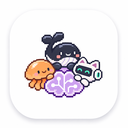

<p align="center">
  
</p>

<h1 align="center">OneBrain Rooms</h1>

<p align="center">
  <b>Claude 写代码，Codex 做审查，都在同一个群里。</b><br>
  开源的 Mac 应用，把你的编程 Agent 拉进同一个群聊。<br>
  每个 Agent 只读它没看过的新消息，整个团队共用一份所有厂商都能读的记忆。
</p>

<p align="center">
  <a href="https://github.com/0xTaoZ/onebrain/releases/latest"><b>下载 Apple 芯片版</b></a>
  · <a href="#安装">安装指南</a>
  · <a href="#对比协作方式">产品对比</a>
  · <a href="#数据">Token 曲线</a>
</p>

<p align="center"><a href="README.md">English</a> · 简体中文 · <a href="README.de.md">Deutsch</a></p>

<p align="center">
  <a href="docs/assets/demo/onebrain-demo.mp4">
    
  </a><br>
  <sub>使用 OneBrain 界面录制，项目与对话为虚构样例。</sub>
</p>

<p align="center">
  <a href="docs/assets/demo/onebrain-demo.mp4">观看英文 MP4</a>
  · <a href="docs/assets/demo/group-chat-zh.png">查看群聊截图</a>
  · <a href="docs/assets/demo/team-brain.png">查看共享大脑截图</a>
</p>

## 你能得到什么

- **Claude、Codex、Gemini 在同一个群。** `@codex` 叫一个人，`@所有人` 每人说一句，不 @ 任何人就自动交给最合适的成员。交接都在同一个对话里完成。
- **长对话少用 80.9% 的输入 Token。** 每个 Agent 记着自己读到哪，只拿新消息；中途加入的审查员拿到一份简短交接，不用重读历史。固定的 100 轮对话实测，[可以自己复现](docs/benchmarks/context-tokens.md)。
- **一个所有厂商都能读的大脑。** 团队的决定和规则放在一个普通的 Markdown 文件夹里，Claude Code、Codex、Gemini 都能直接打开。Git 记录每处改动是哪个 Agent 写的，任何文件都能退回旧版本。
- **放心让它跑。** 每次运行都能撤销，撤销前会提醒你之后手动改过的文件。写到项目外面、改写历史的命令会在审批卡片上标出来，并且永远不能设成"以后都允许"。定时任务照样要审批。

## 安装

| | 一行命令安装（推荐） | 下载 `.dmg` |
| --- | --- | --- |
| **怎么装** | 粘贴到终端运行：<br>`curl -fsSL https://raw.githubusercontent.com/0xTaoZ/onebrain/main/install.sh \| bash` | 在 [Releases](https://github.com/0xTaoZ/onebrain/releases/latest) 下载 `OneBrain_x.y.z_aarch64.dmg`，打开后把 **OneBrain** 拖进「应用程序」 |
| **第一次打开** | 直接就能打开。 | 如果 macOS 拦截，打开 **系统设置 → 隐私与安全性**，点 **仍要打开**。如果提示"已损坏"：`xattr -dr com.apple.quarantine /Applications/OneBrain.app` |
| **需要** | Apple 芯片的 Mac（M1 及以后），以及至少一个已登录的编程 CLI：Claude Code、Codex 或 Gemini CLI | 同左 |

OneBrain 直接用你已经装好的 CLI 和你自己的订阅，不碰你的密钥。装好后在「应用程序」里叫 **OneBrain**。

**第一次聊天：** 欢迎页会列出在你电脑上找到的 Agent。建一个群（聊天群，或者绑定代码文件夹的项目群），点一个示例消息，或者自己写一句。

## 对比协作方式

| 项目 | 运行方式 | Claude + Codex | 文件撤销 | Git 版控共享记忆 | 成员阅读进度 | 可复跑 Token 基准 |
| --- | --- | :---: | :---: | :---: | :---: | :---: |
| **OneBrain Rooms** | 本地 App | ✅ | ✅ | ✅ | ✅ | ✅ |
| [Pachat](https://pachat.ai/use-cases/agent-teams) | 托管群聊 | ✅ | — | — | — | — |
| [Octo](https://www.mininglamp.com/octo/) | 可自托管 | [◐](https://github.com/Mininglamp-OSS/octo-runtime) | — | — | — | — |
| [OpenAgents](https://openagents.org/faq) | 可自托管 | ✅ | — | — | — | — |
| [AionUi](https://github.com/iOfficeAI/AionUi#team-mode--coordinated-multi-agent-collaboration) | 本地 App | ✅ | — | — | — | — |
| [PiBot](https://pibot.space/en/guides/bots-and-roles/#external-agents) | 本地 App | ✅ | [✅ macOS](https://github.com/w01fb0ss/PiBot#what-it-does) | — | — | — |
| [LobeHub](https://github.com/lobehub/lobehub) | 可自托管 | ✅ | — | — | — | — |
| [Claude Code Agent Teams](https://code.claude.com/docs/en/agent-teams) | 本地 CLI | ✗ | — | — | — | — |

**✅** 有公开文档 · **◐** 运行时有文档 · **✗** 超出公开文档中的产品范围 · **—** 在所链接资料里还没找到对应能力。

「Claude + Codex」指两个工具能加入同一个产品工作区。「文件撤销」指恢复 Agent 改过的文件。[Token 基准](docs/benchmarks/context-tokens.md)使用本项目的固定对话回放。

## 数据

<p align="center">
  
</p>

固定对话使用三个 Agent，每轮点名一个。通过应用的提示词构建器重放，用 cl100k 统计输入 Token。

| 轮数 | 提示词＋重读历史 | OneBrain | 比重读历史少 | 比只发提示词少 |
| ---: | ---: | ---: | ---: | ---: |
| 10 | 20,369 | 13,349 | **34.5%** | 16.8% |
| 30 | 90,014 | 37,594 | **58.2%** | 21.8% |
| 60 | 268,112 | 73,399 | **72.6%** | 23.6% |
| 100 | 649,322 | 123,829 | **80.9%** | 22.8% |

第 100 轮加入的审核员，起步输入为 1,775 Token，重读历史的基线为 11,528。这些是基准统计，实际账单取决于厂商计费。

[方法](docs/benchmarks/context-tokens.md)

## 共享大脑

各家厂商的记忆都只留在自己那里：Claude 学到的，Codex 看不到。OneBrain 给整个团队一份记忆，放在 `~/OneBrain/brain`，按 `AGENTS.md` 的约定组织。它越用越好用：任何一个 Agent 记下的决定，下一个 Agent 都能用上，不管它是哪家厂商的。

- **由 Agent 自己维护。** 先读索引，只打开任务需要的文件，边干活边记下决定、规则和交接。积累记忆不额外调用模型。
- **每处改动都有署名。** 这个文件夹是一个 git 仓库。每次运行结束，改动以那个 Agent 的名字提交，每一行都能追到是哪个 Agent、哪次运行写的。
- **看得见成本。** 「共享大脑」页面显示每个 Agent 读它要花多少 Token、谁改了什么，旧版本一键恢复。

## 这些技术怎么落地

| 机制 | 在项目里怎么工作 |
| --- | --- |
| [增量上下文](crates/services/src/services/chat_runner/prompting.rs) | 每个会话成员有自己的阅读进度。续跑时用前缀指纹检查原来的指令是否有变化，再找上次读过的位置之后的消息。新成员可以从已有记录整理出的交接开始。 |
| [共享大脑](crates/services/src/services/brain.rs) | 一个用 git 管理的 Markdown 文件夹。每次运行结束，Agent 的改动以它自己的名字提交；大脑的位置每段对话只告诉 Agent 一次，放在会被缓存的提示词前缀里。 |
| [Git 快照和按次撤销](crates/git/src/checkpoint.rs) | 只回退该次运行碰过的文件。如果运行结束后又有人编辑了这些文件，写入前会检查冲突。 |
| [定时任务](crates/services/src/services/scheduler/mod.rs) | 到期任务先被调度器领取，再走群消息的正常执行路径，沿用群里的审批机制。 |

## 为什么做这个

我会让好几个编程 Agent 做同一件事。大部分花费都用在一遍遍重读同样的历史上；想听第二个意见，就得把需求、diff 和上一个回答从一个终端复制到另一个终端。OneBrain 把它们放进一个群，每个只给它没看过的内容，团队定下的事写进下一个 Agent 能读的文件里。

动手之前，我读了 LobeHub、AionUi 和 PiBot 怎么做记忆、撤销和定时任务，把喜欢的思路用 Rust 重新实现，并且尽量少用 Token。"把记忆放在 Agent 能直接编辑的普通文件里"这个想法来自 poteto 的 [brainmaxxing](https://github.com/poteto/brainmaxxing)。

## 从源码构建

Rust（Axum、SQLx、SQLite）、React 和 TypeScript、Tauri。

```sh
pnpm install
pnpm run check
cargo test --workspace
```

## 关注项目

点个 Star 关注后续进展，也欢迎在 [GitHub Issues](https://github.com/0xTaoZ/onebrain/issues) 说说你第一个群里发生了什么。

---

<sub>Apache License 2.0。基于 OpenTeams（Apache-2.0）开发，见 NOTICE。</sub>
