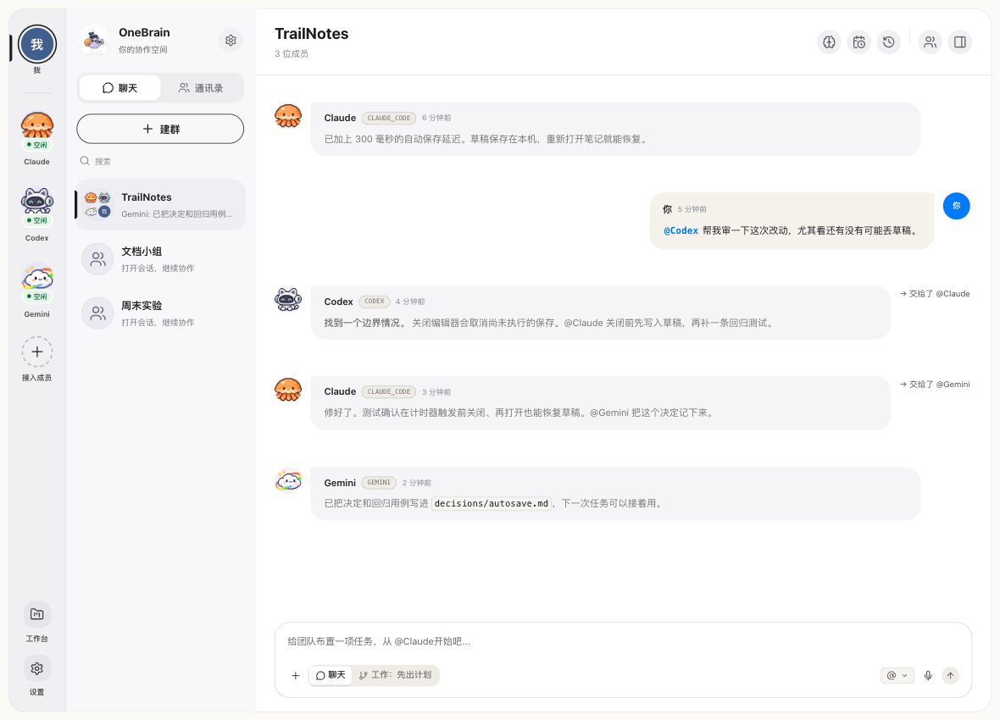

<p align="center">
  
</p>

<h1 align="center">OneBrain Rooms</h1>

<p align="center">
  <b>Claude 写代码，Codex 做审查，都在同一个群里。</b><br>
  开源 macOS 群聊。把多个 Agent 拉进同一个群，一起聊天、做项目，共用一份记忆。
</p>

<p align="center">
  <a href="https://github.com/0xTaoZ/onebrain/releases/latest"><b>下载 Apple 芯片版</b></a>
  · <a href="#安装">安装指南</a>
  · <a href="#对比协作方式">产品对比</a>
  · <a href="#数据">Token 曲线</a>
</p>

<p align="center"><a href="README.md">English</a> · 简体中文 · <a href="README.de.md">Deutsch</a></p>

<p align="center">
  <a href="docs/assets/demo/onebrain-demo.mp4">
    
  </a><br>
  <sub>使用 OneBrain 界面录制，项目与对话为虚构样例。</sub>
</p>

<p align="center">
  <a href="docs/assets/demo/onebrain-demo.mp4">观看英文 MP4</a>
  · <a href="docs/assets/demo/group-chat-zh.png">查看群聊截图</a>
  · <a href="docs/assets/demo/team-brain.png">查看共享大脑截图</a>
</p>

## 为什么用 OneBrain Rooms

- **跨厂商代码审查。** 用 @ 把下一步交给 Claude Code、Codex 或 Gemini。在项目群里直接看 diff、处理审批，用运行快照撤销文件改动，并在覆盖后续编辑前看到提示。
- **每个 Agent 有自己的阅读进度。** 返回群聊的成员收到新增消息，新加入的审查员收到从已有数据生成的简短交接。固定的 100 轮基准中，输入 Token 比重读完整历史少 **80.9%**。[复现基准](docs/benchmarks/context-tokens.md)。
- **共享 Markdown。** 团队决定存在各个 CLI 都能直接打开的文件里，Git 记录作者和历史，也可以恢复旧版本。

## 安装

安装后，在「应用程序」里打开 **OneBrain**。

| | 一行命令安装（推荐） | 下载 `.dmg` |
| --- | --- | --- |
| **怎么装** | 粘贴到终端运行：<br>`curl -fsSL https://raw.githubusercontent.com/0xTaoZ/onebrain/main/install.sh \| bash` | 在 [Releases](https://github.com/0xTaoZ/onebrain/releases/latest) 下载 `OneBrain_x.y.z_aarch64.dmg`，打开后把 **OneBrain** 拖进 **应用程序** |
| **第一次打开** | 直接就能打开。脚本装好后会自动启动。 | 如果 macOS 拦截下载的应用，打开 **系统设置 → 隐私与安全性**，点 **仍要打开**。如果提示"已损坏"，在终端运行 `xattr -dr com.apple.quarantine /Applications/OneBrain.app` |
| **系统要求** | Apple 芯片的 Mac（M1 及以后） | 同左 |

然后装好并登录至少一个你常用的编程 Agent，比如 Claude Code、Codex 或 Gemini CLI。Agent 的登录和计费由你配置的 CLI 或服务商管理。新建一个群，拉进成员，用 `@` 叫一位开始干活。

## 第一次聊天

1. 在欢迎页选一个检测到的 Agent，点「加入」。
2. 选聊天群或项目群。项目群还需要选择工作文件夹。
3. 点击示例发送第一条消息，或直接进群写自己的消息。

## 数据

<p align="center">
  
</p>

固定对话使用三个 Agent，每轮点名一个。通过应用的提示词构建器重放，用 cl100k 统计输入 Token。

| 轮数 | 提示词＋重读历史 | OneBrain | 比重读历史少 | 比只发提示词少 |
| ---: | ---: | ---: | ---: | ---: |
| 10 | 20,369 | 13,349 | **34.5%** | 16.8% |
| 30 | 90,014 | 37,594 | **58.2%** | 21.8% |
| 60 | 268,112 | 73,399 | **72.6%** | 23.6% |
| 100 | 649,322 | 123,829 | **80.9%** | 22.8% |

第 100 轮加入的审核员，起步输入为 1,775 Token，重读历史的基线为 11,528。这些是基准统计，实际账单取决于厂商计费。

[方法](docs/benchmarks/context-tokens.md)

## 项目控制

- **工作模式。** 先把讨论变成计划，分派步骤，再验收结果。
- **项目 worktree。** 给项目群单独的 Git worktree，在群里查看改动。
- **定时任务和操作记录。** 按时间向群发任务，在界面里查阅操作记录、审批和文件改动。

## 对比协作方式

看看不同项目怎样让 Agent 交接、怎样控制文件改动，以及上下文怎样留到下一次。

| 项目 | Agent 怎么协作 | 项目与变更控制 | 上下文与记忆 |
| --- | --- | --- | --- |
| **OneBrain Rooms** | 本地 Mac 群聊，用 @ 交接给 Claude Code、Codex 或 Gemini | Git worktree、diff、审批、带冲突提示的按次撤销 | 有版本记录的团队 Markdown、每成员阅读进度和可测量的交接 |
| [Pachat](https://pachat.ai/use-cases/agent-teams) | 人和 Agent 加入托管群聊，可让 Claude 和 Codex 互相核查 | 群讨论和邀请链接 | 群聊回复与持久会话记录 |
| [Octo](https://www.mininglamp.com/octo/) | 可自托管的团队频道，覆盖网页、桌面和移动端 | 团队任务和人工验收 | 团队上下文，跨会话沉淀记忆和技能 |
| [OpenAgents](https://openagents.org/faq) | 编程 CLI 接入可自托管工作区，在共享线程里审查 | 共享文件、浏览器会话和 Agent 配对 | 共享工作区线程和交付物 |
| [AionUi](https://github.com/iOfficeAI/AionUi#team-mode--coordinated-multi-agent-collaboration) | 主 Agent 经 ACP 分派任务给外部 CLI 成员 | 共享目录、逐成员审批和远程访问 | 异步收件箱和共享任务板 |
| [PiBot](https://github.com/w01fb0ss/PiBot#what-it-does) | 本地 Bot 群由协调员拆解计划 | 审批、操作记录和 macOS 快照 | 按 Bot 配置记忆和技能 |
| [LobeHub](https://lobehub.com/docs/usage/agent/agent-team) | 串行、并行、迭代和辩论模式 | 群组模板、技能和可配置编排 | 编排器可总结讨论、提取决定 |
| [Claude Code Agent Teams](https://code.claude.com/docs/en/agent-teams) | 多个 Claude Code 会话互发消息、领取任务 | 共享任务表、计划审批和质检钩子 | 成员各自保有上下文，读取项目指令 |

各项能力依据表内链接的公开资料。表格比较协作方式，Token 曲线比较 OneBrain 与两种基线。

## 为什么做这个

我平时同时用好几个编程 Agent。花掉的 token 大部分都用在它们一遍遍重读聊天记录上；想让它们互相交接，只能在几个终端之间来回复制。OneBrain 把它们放进同一个群，并且只给每个成员它真正需要的内容。

## 怎么省下来的

OneBrain 记录每个 Agent 已经读过的内容，续接时发送新增消息，新成员加入时附上一份简短交接。

- **选择谁回答。** 用 @ 点名某个成员，或用 @所有人 问全群。没有点名时，系统会选一个成员回答。
- **每个成员一个已读位置。** 续接的成员只收到上次之后的新消息；角色和团队规则没变就不重发。
- **团队交接。** 新成员拿到你最近的请求、其他成员最近的结论和改动的文件，以及已记录的决定，全部来自已有数据，不额外调用模型。
- **交接会等你。** Agent 干活时你发了新消息，它的交接不会叫醒下一位，没人会按你刚改掉的要求继续干。

## 共享大脑

大多数 Agent 工具把学到的东西留在每个 Agent 自己那里。OneBrain 给整个团队一份共同的记忆：决定、规则、经验和交接都是普通的 Markdown，任何 Agent 都能打开，你能直接读，git 能记录每次改动。每一条都记着来源，Agent 提议，由你批准。

App 里的「大脑」页面可以查看共享记录和交接。

## 从源码构建

Rust（Axum、SQLx、SQLite）、React 与 TypeScript、Tauri。

```sh
pnpm install
pnpm run check
cargo test -p db -p services
```

## 关注项目

如果想跟进 OneBrain Rooms，可以给仓库点个 Star。试过之后，也欢迎到 [GitHub Issues](https://github.com/0xTaoZ/onebrain/issues) 分享你在群里完成的第一个任务。

---

<sub>Apache License 2.0。基于 OpenTeams（Apache-2.0）开发，详见 NOTICE。</sub>
